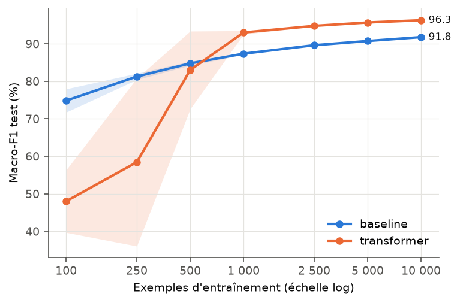
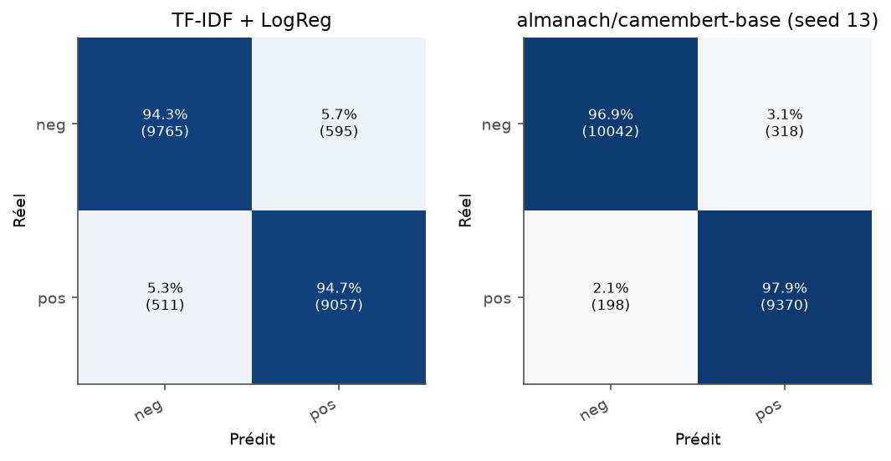
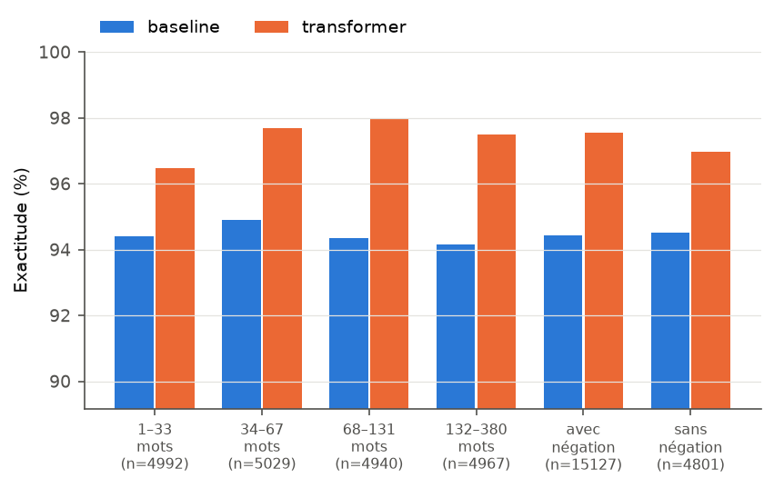
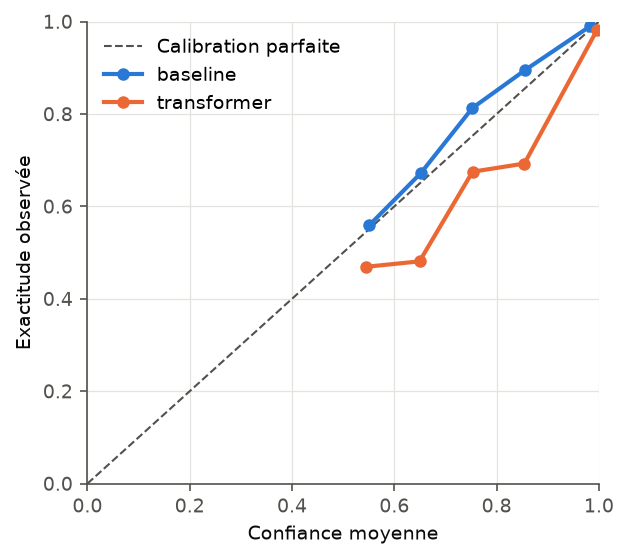

# Rapport — allocine

Jeu de données : `tblard/allocine` · classes : neg, pos ·
train / val / test = 159420 / 19933 / 19928 · empreinte du test : `c8157e050b1d8bd7`

## 1. Performance sur le test

| Modèle | Accuracy (IC 95 %) | Macro-F1 (IC 95 %) | ECE |
|---|---|---|---|
| TF-IDF + LogReg (word_1_2+char_2_5, C=4) | 94.45 [94.12, 94.77] | 94.44 [94.11, 94.76] | 1.34 |
| almanach/camembert-base (seed 13) | 97.41 [97.20, 97.63] | 97.41 [97.20, 97.62] | 1.66 |
| almanach/camembert-base (seed 2024) | 97.45 [97.24, 97.66] | 97.45 [97.24, 97.66] | 1.58 |
| almanach/camembert-base (seed 42) | 97.41 [97.20, 97.64] | 97.41 [97.20, 97.64] | 1.64 |
| **almanach/camembert-base — moyenne ± écart-type (3 seeds)** | **97.42 ± 0.02** | **97.42 ± 0.02** | **1.63 ± 0.04** |

Les intervalles de confiance à 95 % sont obtenus par bootstrap percentile (1000 rééchantillonnages du test).
ECE = erreur de calibration attendue (15 intervalles, en points de %).

## 2. Significativité de l'écart (transformer − baseline)

| Seed | Δ Macro-F1 (pts) | p (bootstrap apparié) | Seule baseline correcte | Seul transformer correct | p (McNemar) |
|---|---|---|---|---|---|
| 13 | +2.96 [+2.66, +3.28] | < 0.001 | 205 | 795 | 1.98e-77 |
| 2024 | +3.01 [+2.70, +3.32] | < 0.001 | 209 | 807 | 2.84e-78 |
| 42 | +2.96 [+2.66, +3.29] | < 0.001 | 215 | 805 | 6.01e-76 |

## 3. Coût

| Modèle | Paramètres | Taille (Mo) | Entraînement | Inférence (ex./s) | Matériel d'inférence |
|---|---|---|---|---|---|
| TF-IDF + LogReg | 910 455 | 38.6 | 282 s | 662 | cpu |
| almanach/camembert-base | 110 623 490 | 442.5 | 37.0 min | 393 | Tesla T4 |

## 4. Efficacité en données

Macro-F1 test (%), moyenne ± écart-type sur 3 tirage(s) du sous-échantillon :

| Exemples | baseline | transformer |
|---|---|---|
| 100 | 74.85 ± 3.10 | 48.02 ± 8.33 |
| 250 | 81.26 ± 0.84 | 58.43 ± 22.36 |
| 500 | 84.77 ± 0.54 | 83.01 ± 10.37 |
| 1000 | 87.36 ± 0.27 | 93.02 ± 0.47 |
| 2500 | 89.62 ± 0.10 | 94.78 ± 0.14 |
| 5000 | 90.75 ± 0.08 | 95.68 ± 0.04 |
| 10000 | 91.79 ± 0.13 | 96.28 ± 0.13 |

## 5. Analyse d'erreurs (transformer : seed 13, choisi par score de validation médian)

| Tranche | n | Acc. baseline | F1 baseline | Acc. transformer | F1 transformer |
|---|---|---|---|---|---|
| 1–33 mots | 4992 | 94.39 | 94.33 | 96.47 | 96.44 |
| 34–67 mots | 5029 | 94.89 | 94.88 | 97.69 | 97.69 |
| 68–131 mots | 4940 | 94.35 | 94.35 | 98.0 | 97.99 |
| 132–380 mots | 4967 | 94.16 | 94.16 | 97.48 | 97.48 |
| avec négation | 15127 | 94.43 | 94.32 | 97.55 | 97.51 |
| sans négation | 4801 | 94.52 | 94.01 | 96.96 | 96.67 |

Les exemples de désaccord (erreurs les plus confiantes de chaque modèle) sont dans `disagreements.csv`.
